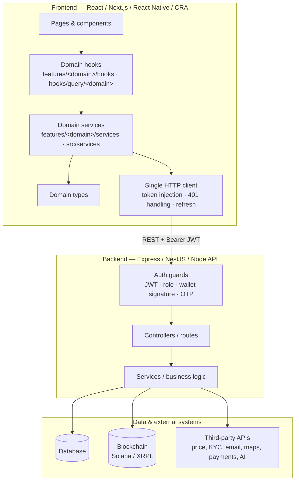
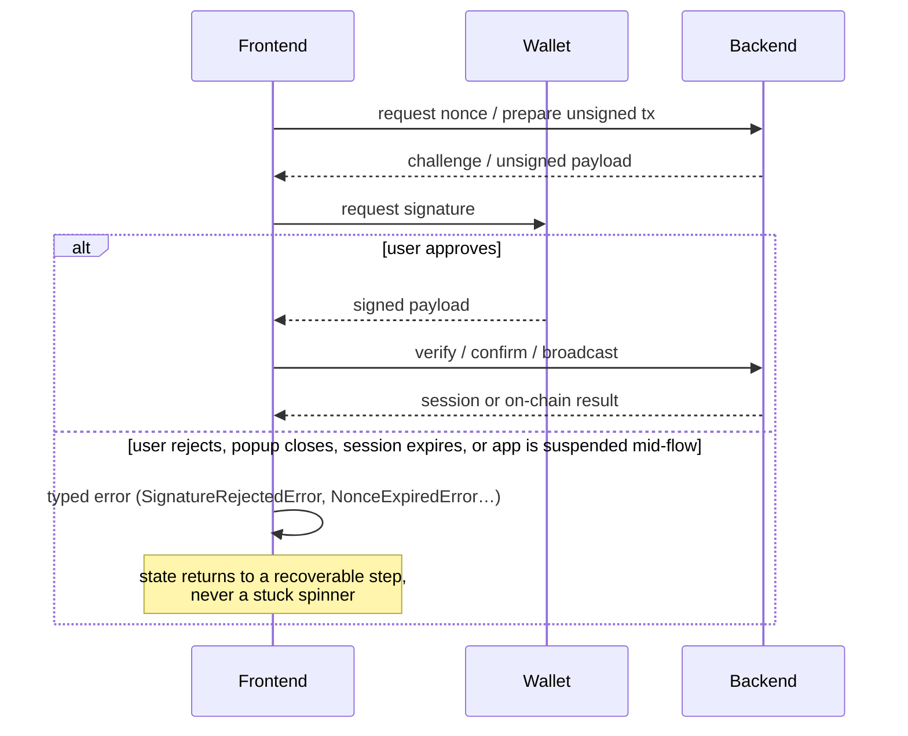

# Engineering Experience — Shehryar

_A consolidated, evidence-based profile built from eight production codebases: TWQ (Solana token intelligence), Dibzi (NFC loyalty + blockchain), FinTrust (Solana staking/ICO), Flyverr (resale marketplace), Lindo Mart (internal operations platform), SocialFi Trading (content-as-assets social trading platform), Mindful Oasis (wellness platform with on-chain rewards), and Social Locket (real-estate social marketplace). Every fact below is traceable to a specific file, folder, or line in one of those repositories. Where a number would require data the repositories don't have — traffic, revenue, user counts, employment dates — it's left out rather than estimated, matching the convention the deepest of these source documents already set (TWQ, Dibzi, FinTrust, Flyverr, Lindo Mart, and SocialFi Trading each carry their own detailed case-study or evidence document; Mindful Oasis and Social Locket are assessed directly from their source code and API/setup docs, since no equivalent case-study file exists for them)._

> **On "three years."** You asked this document to reflect experience built over the last three years. The verified commit history in this workspace only confirms specific windows for three projects — Dibzi (Apr–Oct 2025), Flyverr (active Aug 4–27, 2025, within a Jul–Oct 2025 repo), and Lindo Mart (Sept–Nov 2025) — and the other five projects carry no in-repo date or commit-authorship record to verify against. Rather than assert a three-year timeline that isn't independently checkable from what's in this workspace, this document describes the work itself in detail and lets the breadth and depth speak for the experience; if you want the timeline stated explicitly, that's a fact only you can supply; I can add it as a stated fact on your say-so.

---

## Professional Summary

Full-stack and blockchain engineer whose strongest, most consistently repeated work is the seam between frontend and backend: designing the HTTP integration layer, the auth/session model, and the data-shape boundary everything else in an application is built on top of — then building the product features, including full social-platform and marketplace features, that sit on it. Across eight independent production systems, spanning four backend stacks (Express, NestJS, a bare Node/Express API, and Solana/Anchor and XRPL blockchain programs) and three frontend generations (Next.js, Create React App, React Native), the same pattern recurs: a single HTTP client with centralized token handling, a domain-scoped services/hooks convention, and multi-step async flows (wallet signing, OTP verification, Stripe/PayPal checkout, deep-link round trips) modeled as explicit state machines instead of ad hoc loading flags. Two of the eight systems — SocialFi Trading and Social Locket — are social platforms in the literal sense: one prices every post and comment as a tradeable on-chain asset, the other is a social marketplace for real-estate listings, matching, and offers.

**What ties the eight systems together, beyond "full-stack":**

- A backend-consuming frontend is never allowed to see a raw third-party or backend payload shape directly — every project converts at a service boundary before a component or hook ever touches the data.
- Every multi-step async user action that can fail halfway (wallet sign, OTP verify, Stripe/PayPal redirect, OS-level share-sheet handoff) is modeled as an explicit state machine with typed, distinguishable errors, not a single `isLoading` boolean.
- Authorization is always re-verified server-side on the sensitive path, even when a faster client-cached value exists for instant UI feedback — the fast value is for responsiveness, never for the actual access decision.
- Missing or incomplete third-party data is treated as a domain question ("what does absence mean here"), not a validation failure to reject.
- Reference/lookup data (currencies, categories, bedroom counts, alert types) is pulled through a shared, reusable data-fetching layer instead of being re-fetched or hardcoded per screen — this exact pattern shows up independently in Lindo Mart's `/public` lookup endpoints and Social Locket's shared reference-data hooks.

---

## How I Engineer

Five habits that show up, independently re-derived, across all eight codebases — each backed by the specific place it cost something, because a principle that never costs anything isn't a principle.

**1. Understand the constraint before choosing the tool.** The question that actually decides an architecture is rarely "which library" — it's "what does the thing I'm integrating with do if I'm slow, wrong, or offline." In TWQ, that's "what does Helius do if my webhook handler is slow" (it disconnects and the event is lost — so the handler ACKs before it validates anything). In Dibzi, it's "what happens to already-issued rewards when a merchant edits their tier artwork," a question that only surfaced after the original IPFS pipeline had already been fully built and tested. In SocialFi Trading, it's the same question asked of a live trading engine: recomputing a trade's cost from _live on-chain state_ rather than a cached database row exists specifically because a documented bug class ("stale-DB slippage") was traced back to trusting the wrong source of truth.

**2. Model the thing that actually exists, not the thing that's convenient to store.** In Dibzi, loyalty state doesn't belong to the customer or the merchant — it belongs to the relationship between them, so it's its own entity. In Lindo Mart, a form's recipient isn't a role-vs-user string comparison — it's an explicit `recipientType: 'general' | 'specific'` enum plus a typed reference. In Social Locket, a "property wanted" listing is modeled as its own listing type with its own matching and offer endpoints, rather than a flag on a normal listing — because what a buyer is looking for and what a seller is offering are genuinely different objects with different lifecycles.

**3. Design the failure state explicitly, before the demo needs it.** Every external dependency will fail — a webhook provider, a wallet extension, an LLM API, an RPC node, a Redis instance, an OS-level share sheet. Across all eight projects, the design question is always "what happens when this specific thing is down," decided in advance and written into the code: TWQ's rule-based fallback when OpenAI fails, FinTrust's write-ahead-log disbursement engine that survives a crash mid-transfer, Dibzi's three-state hardware handling (absent / disabled / working), SocialFi Trading's mobile trade-confirmation screen that automatically re-fetches a fresh unsigned transaction and reopens the wallet if the backend reports a stale account or an expired transaction, and Mindful Oasis's hot-wallet auto-refill that tops up a reward wallet before a balance shortfall can block a user's claim.

**4. Make the safe path the default path.** Security or correctness that depends on a developer remembering something will eventually fail. In Dibzi, invitation-token validity is expressed inside the MongoDB query predicate itself, not checked after the fetch. In FinTrust, a conditional `updateMany` encodes the precondition directly in the `WHERE` clause so a "flip this exactly once" invariant can't race, by construction. In SocialFi Trading, an idempotency key derived from the on-chain transaction signature (`sha256("onchain:" + txSignature)`) means the blockchain event indexer literally cannot double-write a trade the synchronous path already recorded — the safety isn't a check, it's a database constraint.

**5. Judge it by the outcome, and say plainly what's still wrong.** Shipping isn't the finish line, and pretending a system has no gaps is a worse failure than having them. Every one of these projects with a dedicated case-study document ships with a named, ranked list of what's actually broken or incomplete — Dibzi's unauthenticated admin-creation route, Flyverr's dead `StripeOnboardingModal` component, FinTrust's card-limit drift from its own whitepaper, TWQ's inverted BullMQ priority bug, and SocialFi Trading's explicitly `describe.skip`'d `content-escrow` test suite with an in-file comment explaining exactly why it's disabled and what has to happen before it's re-enabled. Naming these before someone else finds them is treated as part of the engineering work, not an admission that undermines it.

---

## What I've Engineered — System Overview

| System               | Domain                                                                                      | My scope                                                                                                              | Stack                                                                                        | Verified ownership                                                                    |
| -------------------- | ------------------------------------------------------------------------------------------- | --------------------------------------------------------------------------------------------------------------------- | -------------------------------------------------------------------------------------------- | ------------------------------------------------------------------------------------- |
| **TWQ**              | Real-time Solana token tracking, alerting, AI advisory                                      | Solo: backend, frontend, all 8 external integrations                                                                  | Node/Express, MongoDB, Redis, BullMQ, Next.js 14, React 18, TypeScript                       | First-person solo build; no in-repo commit-percentage record                          |
| **Dibzi**            | NFC-triggered on-chain loyalty platform                                                     | Mobile app, backend API, blockchain minting, 2 role-scoped dashboards                                                 | Expo/React Native, Node/Express, MongoDB, ethers.js, React 19/Vite                           | 237 of 264 commits (90%) across 4 codebases, Apr–Oct 2025                             |
| **FinTrust**         | Solana staking, rewards, ICO, and card-spend platform                                       | Full stack + Anchor smart contract                                                                                    | NestJS, PostgreSQL/Prisma, Redis/BullMQ, Anchor/Rust, Next.js 16 (frontend + admin)          | First-person build/audit; no in-repo commit-percentage record                         |
| **Flyverr**          | Staged resale marketplace for digital products                                              | Frontend architecture from an empty scaffold: auth, API layer, purchase/licensing, admin back-office                  | Next.js 15, React 19, TypeScript, TanStack Query, Stripe Connect                             | 53 of 122 commits, active Aug 4–27, 2025                                              |
| **Lindo Mart**       | Internal operations platform (inventory, forms, safety reporting)                           | New reference-data subsystem end to end, form workflow rebuild, 6 authorization/data-integrity fixes in existing code | NestJS, MongoDB/Mongoose, React 18, TanStack Query, Socket.IO                                | 55 of 88 frontend commits, 18 of 43 backend commits, Sept–Nov 2025                    |
| **SocialFi Trading** | Content-as-assets social trading platform (posts/comments priced on a Solana bonding curve) | Full stack + 4 Anchor smart contracts + React Native mobile app + admin console                                       | NestJS, PostgreSQL/Prisma, Redis/BullMQ, Anchor/Rust, React Native, React 19/Vite admin      | First-person, code-verified; no in-repo commit-percentage record                      |
| **Mindful Oasis**    | Wellness/meditation platform with claimable XRPL token rewards                              | Full stack: React frontend, Node/Express API, XRPL integration                                                        | React/Vite, TypeScript, Node/Express, MongoDB, XRPL (xrpl.js), Xaman/XUMM wallet auth        | Assessed from source code; no case-study document or commit-authorship record in-repo |
| **Social Locket**    | Real-estate social marketplace (listings, matching, offers, groups)                         | Frontend (React) — listing/marketplace workflows, payments and auth UI                                                | Create React App, React 18, React Query/TanStack Query, Stripe, PayPal, Web3Modal/wagmi/viem | Assessed from source code; no `.git` history present in this workspace copy           |

---

## Architecture — The Pattern Across Projects

The same shape recurs across all eight systems, independently arrived at each time rather than copy-pasted from one project to the next (they're built on four different backend approaches and, in three cases, on different blockchains — Solana, XRPL — entirely):

**Why this shape holds up under eight different projects:** the moment an external payload shape — a third-party API response, a raw database document, a wallet adapter's connection object — reaches a component or hook directly, that component is now coupled to something outside this codebase's control. Converting to a domain type at the service boundary means a provider changing its response, or a backend field being renamed, is a one-file change instead of a search-and-replace across the UI. This is stated explicitly in several of the source documents (TWQ, Flyverr, FinTrust, SocialFi Trading) and is structurally present, even where unstated, in the rest — including Social Locket's `services/` folder of one-file-per-domain API wrappers and Lindo Mart's `/public` field-limited endpoints feeding shared React Query hooks.

### The recurring sub-pattern: multi-step async flows as state machines

Three unrelated projects — TWQ, FinTrust, and SocialFi Trading — each independently arrived at the same solution for the hardest frontend problem a wallet-based product has: a signature flow with several async failure points (closed popup, expired challenge, disconnected extension, wrong wallet, a mobile OS suspending the app mid-round-trip). Rebuilding this three times, in three unrelated codebases against three different backends, without one project being derived from another, is itself evidence this is a considered pattern rather than a one-off:

In TWQ (`useSolanaWallet.ts`), the phases are `requesting_nonce → signing → logging_in`, each attempt carries an ID checked before any state write, and values read inside async callbacks are held in refs to dodge stale-closure bugs. In FinTrust (`WalletContext.tsx`), a derived `effectivePublicKey` only resolves once a wallet is simultaneously connected, JWT-authenticated, and confirmed to be the exact wallet the JWT was issued for, plus an 800ms grace period on a focus-based cancel detector, because the browser's `focus` event and the wallet adapter's connection promise aren't ordered relative to each other. In SocialFi Trading (`phantomDeeplink.ts`), the same problem is solved a third way, at the OS level rather than the browser level: an ephemeral dapp keypair and the resulting wallet session are persisted in encrypted local storage specifically so the flow survives the mobile app's process being recreated mid-round-trip by the OS, and the trade-confirmation screen transparently re-triggers the connect flow and resumes a pending trade if the session has expired while the user was in the wallet app.

---

## What I Engineered, Per Project

### TWQ — Real-time Solana token tracking, alerting, and AI advisory

**What I engineered.** The entire platform, alone: webhook ingestion, the queueing/worker system, wallet-based cryptographic auth, the alert-matching and notification engine, an AI prediction layer grounded in from-scratch technical indicators, and the Next.js frontend consuming all of it.

**On the frontend side specifically**, the integration boundary is a single HTTP client that attaches the JWT and clears the session on a 401 — there are no ad-hoc `fetch` calls anywhere in the codebase. Services convert every provider payload into internal domain types before a hook ever sees it. Cache lifetimes are set by how fast the underlying data actually changes: thirty seconds for live prices, up to twenty-four hours for reference data that effectively never moves.

**Engineering decisions.**

- **Acknowledge before processing.** Helius disconnects on a slow webhook response, so the handler returns `200` before doing any real work, writes the event to a capped Redis Stream, and lets a separate worker pool process it. _Cost:_ the system becomes eventually consistent.
- **Missing liquidity means "skip this check," not "reject this token."** A naive `>=` filter would silently discard exactly the tokens the product exists to surface. _Cost:_ more false positives, judged acceptable because a missed alert is worse than an extra one.
- **Compute real indicators, use the model only to explain them, cache the result, keep a non-AI fallback.** Eight technical indicators are computed from raw price history with no charting library; if OpenAI fails, a weighted rule-based scorer produces a real prediction from the same indicators. _Cost:_ a cached answer can be up to three hours stale.

**Numbers.** 8 external providers integrated end to end; 8 technical indicators implemented from primary formulas; 3 BullMQ queues; 3 notification delivery modes; a Redis Stream capped at roughly 100,000 entries; a 180-minute AI prediction cache; 2 codebases kept in sync solo; 0 passwords or private keys stored.

**Result.** Token research moved from a manual routine across several disconnected tools to a single workflow that runs unattended. Webhook acknowledgment is fully decoupled from processing, so a slow third-party API or a stalled worker can no longer cause a dropped event. No production usage metrics are claimed — the source document is explicit that impact is described only in terms of what changed structurally.

---

### Dibzi — NFC-triggered on-chain loyalty platform

**What I engineered.** The dynamic NFT metadata architecture that makes the tier-upgrade mechanic possible, the tier-resolution engine that makes downgrading a customer structurally inexpressible, the NFC hardware session lifecycle, the Node/browser build bridge for the admin dashboard's Web3/IPFS dependencies, and the schema migration that shipped per-visit history over three simultaneously-live data formats with no downtime — across four codebases, authoring 90% of all commits.

**Frontend/integration angle.** Two role-scoped React dashboards and one React Native mobile app consume one REST API through three distinct auth guards read from the database on every request. The admin dashboard's biggest integration challenge was making a Node-only Web3/IPFS dependency tree bundle for a browser at all, solved with an explicit Node-builtin alias map, a dev/prod-specific polyfill plugin pair, and a 15-line interop shim for one transitive dependency with no documented fix anywhere.

**Engineering decisions.**

- **Inverted which part of the NFT metadata is fixed.** The token's URI became a permanent address pointing at Dibzi's own API; the document it returns is computed at request time from live database state, instead of being pinned to IPFS. The full working IPFS pipeline was built and thrown out once its immutability was understood to be structurally wrong for an editable reward.
- **Recompute tier eligibility from thresholds on every check-in, never from a stored position.** Because each tier is a blockchain token, an incorrect downgrade is a permanent, public record — made structurally inexpressible rather than merely guarded against.
- **Guarantee NFC hardware-lock release in a `finally` on every exit path**, and bound every wait with an explicit 60-second timeout.

**Numbers.** 237 of 264 commits (90%) across four codebases over six months (Apr–Oct 2025); 6,733 / 13,370 / 7,595 / 6,753 LOC across the backend, mobile app, admin dashboard, and merchant dashboard respectively; 3,345 lines of technical documentation, sole author; 11 vendor-chunk groups for the admin dashboard's build split; a ranked defect audit (6 P0, 5 P1, 12 P2 issues), including honest findings against my own work.

**Result.** Tier progression — the mechanic the entire product is built on — became possible at all; artwork and copy on already-issued rewards are updated from a web form at no blockchain cost. A hardware interaction that previously failed silently now distinguishes absent hardware from disabled hardware. Per-visit history shipped over three live schema formats with zero downtime and zero data loss.

---

### FinTrust — Solana staking, rewards, and ICO platform

**What I engineered/analyzed.** A non-custodial staking-and-rewards protocol with weekly on-chain reward snapshots, vesting-NFT reward claims, a referral program, a cashback pool, KYC/whitelist compliance gating, and tier-based card spend limits — backed by a custom 2,430-line Anchor smart contract, a 25-module NestJS backend, and two Next.js frontends.

**Frontend/integration angle.** Every on-chain user action is split into `prepare*` (server builds an unsigned transaction, no DB write) and `confirm*` (submits the wallet-signed transaction, writes to Postgres only after chain confirmation). A single derived value (`effectivePublicKey`) gates every data-fetching hook in the app, resolving only once a wallet is simultaneously connected, JWT-authenticated, and confirmed to be the exact wallet the JWT was issued for.

**Engineering decisions.**

- **Exactly-once disbursement over an at-least-once blockchain primitive.** A write-ahead-log row is inserted _before_ submission, and the transaction signature is persisted in a _separate_, unconditional write outside the failed transaction if effects-application fails afterward, so a reconciler or the blockchain indexer can finish the job without ever resubmitting. _Cost accepted, stated directly in the code:_ "we cannot prove the original tx did not land — retrying could double-spend."
- **Conditional `updateMany` instead of a distributed lock**, for every "at most once under concurrent triggers" invariant. _Cost:_ the losing caller in a race gets no feedback about why nothing happened.
- **Re-derive and re-verify every attacker-suppliable account on-chain**, rather than trusting that an account exists and deserializes.

**Numbers.** 60,220 lines of TypeScript/TSX/Rust source; 254 TS/TSX files; 37 Prisma models; 25 NestJS modules; 157 HTTP routes; 27 on-chain instructions and 36 custom error codes in a single 2,430-line Anchor program; 239 automated tests (177 backend + 62 Anchor) plus a 34-flow manual QA runbook.

**Result.** The double-pay / lost-pay failure class on admin-signed disbursements is closed by construction. Dropped blockchain events self-heal within one polling interval instead of surfacing as a user-reported incident. Where the system's enforcement drifts from its own published tokenomics whitepaper, that's named directly rather than glossed over.

---

### Flyverr — Staged resale marketplace platform

**What I engineered.** The entire frontend foundation, from an empty `create-next-app` scaffold: `AuthContext`, `ProtectedRoute`, the shared Axios/TanStack Query integration convention, and the dashboard shell used by every authenticated screen — followed by the two highest-complexity product surfaces built on top of it, plus an admin back-office built on two shared primitives instead of per-screen hand-rolled tables.

**This is the project most directly about frontend architecture and backend API integration**, because there was no prior convention to extend — the `features/<domain>/{services, hooks, types}` pattern was established from a blank slate and then adopted by a teammate for unrelated features for six weeks after this engineer's own commits stopped, verifiable in git history.

**Engineering decisions.**

- **Split a fast, client-cached access check from a slow, authoritative one** — only the slow one is ever the real gate. `ProtectedRoute` waits on a live `useGetCurrentUser()` query, not the cached `AuthContext` flag.
- **One HOC (`withStripeOnboarding`) instead of four hand-rolled readiness checks**, centralizing an ordered `requireReady()` chain so the precondition changes once, in one place, instead of four call sites drifting apart.
- **Cache invalidation over manual cache patching.** Every mutation invalidates specific TanStack Query keys rather than hand-mutating cached objects.

**Numbers.** 53 of 122 commits, active Aug 4–27, 2025; 6 top-level and 17 sub-level feature domains; 1 HOC reused across 4 action components; 1 `AdminTable` reused across 11 admin/user pages, 1 `PaginationControls` reused across 10; the exact staged-pricing multipliers the admin approval flow auto-suggests (1.2× / 1.4× / 1.6×).

**Result.** A genuinely unusual multi-round resale/licensing business model shipped as a deterministic, unambiguous buyer experience. The architecture established here was still what a teammate built unrelated features on top of six weeks after this engineer's own involvement ended — the strongest evidence in any of the eight projects that a pattern generalizes beyond its author.

---

### Lindo Mart — Internal operations platform

**What I engineered.** A 9-domain reference-data subsystem built from scratch across 8 REST controllers and 5 NestJS modules, matched end-to-end by React Query hooks and admin CRUD pages — plus a rebuild of the platform's core multi-step form-submission workflow, and six real authorization/data-integrity defects found and fixed in code originally written by another engineer.

**Frontend/integration angle.** Every reference-data module exposes a second, field-limited `/public` endpoint alongside its admin CRUD routes, letting regular staff pull real inventory/equipment/alert options into a form dropdown without ever being granted admin access — and it only actually worked once a JavaScript-truthiness bug in the shared `RolesGuard` was fixed (an empty `@Roles()` array is truthy, so "no roles required" was silently rejecting every request to every intended-public route).

**Engineering decisions.**

- **One generic schema and component set for five structurally identical "alert" features**, parameterized by `type`/`baseRoute`/`title` at the route level, instead of five near-duplicate CRUD stacks.
- **Redesigned `Form` references from raw strings to typed MongoDB `ObjectId`s**, and rewrote the visibility query to branch explicitly on an unambiguous `recipientType` enum — closing a real case where a Supervisor could read a form addressed to a different Supervisor.
- **An explicit `isLoading` flag over a synchronously-derived auth state**, after tracing a "hard refresh logs valid users out" bug to a race between a synchronous check and an async `localStorage` read.

**Numbers.** 8 backend REST controllers / 5 NestJS modules covering 9 data domains; 7+ form types behind 1 validation dispatcher; 4 user roles; 6 real defects found and fixed in pre-existing code; 55 of 88 frontend commits, 18 of 43 backend commits; ~150 lines of duplicated markup removed by extracting one reusable component.

**Result.** Every `/public` endpoint now returns data instead of rejecting every caller. Non-Super-Admin roles now see only the dashboard statistics and forms actually addressed to them. A hard page refresh no longer ejects an authenticated user to the login screen.

---

### SocialFi Trading — Content-as-assets social trading platform

**What I engineered.** A social platform where every post and comment is a tradeable financial instrument priced on a Solana bonding curve — the NestJS backend, four Solana Anchor smart contracts, a React Native mobile app with native iOS/Android integrations, and a React admin/moderation console, all wired to a single, consistent fee and data model. This is the most directly "social media" of the eight projects: real-time comment threads, content sharing/import from other apps, in-app audio/video comments, a social graph, and a moderation pipeline all sit alongside the financial engineering.

**Frontend/integration angle.** Buy/sell mutations attach a client-generated idempotency key to every request; on success, the app opens the user's wallet via a deep link, and the mutation invalidates a wide, deliberate set of React Query cache keys (feed, market, holdings, portfolio, wallet transactions, leaderboard, career-impact) because a single trade changes data displayed on many otherwise-unrelated screens. A native iOS Share Extension (Swift, App Groups, `UserDefaults` handoff) lets a user share content from another app directly into a post, bridged into the React Native layer via a patched third-party module. Real-time comments and live prices reach the client over a Socket.IO gateway with per-entry and per-user rooms, backed by a transactional outbox so a notification can never be lost between being recorded and being delivered.

**Engineering decisions.**

- **Migrated the trading engine from a custodial, database-only ledger to a non-custodial, wallet-signed model**, retaining the deprecated custodial methods in the codebase as direct evidence of a real architectural migration rather than a from-scratch design. Recomputing trade cost from _live on-chain state_ rather than the cached database copy was the fix for a documented, named bug class ("SlippageExceeded caused by stale DB supply").
- **Kept the bonding-curve pricing formula and fee constants numerically identical across Rust and TypeScript**, tested independently on both sides (`test_claim_fee_split_700_bps` in Rust, a matching spec in the backend) rather than sharing one implementation, because an Anchor program and a NestJS backend can't literally share code.
- **Remediated two real security weaknesses**, a platform signer keypair sitting in plaintext environment variables and a single hardcoded local-storage encryption key shared across every mobile install — shipping a secrets-abstraction service for the first and a per-install random key with a one-time, backward-compatible migration for the second, so existing users weren't broken by the fix.
- **Built admin-only on-chain recovery instructions** (`force_close_market`, `force_close_creator_vault`) that deliberately bypass normal Borsh deserialization to recover PDAs left in an old, incompatible layout after a program upgrade — a purpose-built fix for a real incident (Anchor error 3003), not a hypothetical.

**Numbers.** ~30 NestJS backend modules (trading, blockchain, notifications, moderation, staking, lending, dao, token, promotion, admin-api); 4 Anchor/Rust smart contracts; a ~1,150-line Prisma schema with an explicit `LedgerAccount` enum and a three-table earnings-accounting split; 15 active on-chain integration test scenarios plus one explicitly disabled and documented test suite; a native iOS Share Extension target; 11 routed admin pages with 4 Recharts analytics visualizations backed by dedicated aggregation endpoints.

**Result.** The custodial-fund-risk failure class is closed by construction — the platform never holds user SOL for trading. The specific stale-DB slippage bug the migration was built to fix is closed by design. A security review's two named findings (plaintext secrets, a shared hardcoded encryption key) were fixed with a migration path that didn't require existing users to reinstall or lose data. No production usage, revenue, or user-count figures are claimed anywhere in the source document, consistent with its own explicit "Needs Confirmation" section.

---

### Mindful Oasis — Wellness platform with on-chain rewards

**What I engineered.** A mindfulness and meditation platform spanning ten distinct activity modalities (breathwork, timed meditation, gratitude journaling, 5-4-3-2-1 grounding, mindful listening, mindful eating, yoga, tai chi, mandala drawing, poetry reflection), gamified with daily streaks and levels, and backed by a claimable XRPL token reward system — the React/Vite frontend, the Node/Express/MongoDB API, and the XRPL integration layer end to end.

**Frontend/integration angle.** The frontend authenticates against the backend with a standard JWT flow and, separately, against XRPL through Xaman/XUMM wallet connection for reward claims — two distinct identity concerns (application account vs. reward-claim wallet) kept as two separate flows rather than conflated into one. A dedicated `useXummAuth` hook and `WalletConnect` component isolate the wallet-specific logic from the rest of the app, following the same "keep the integration surface in one place" instinct visible in every other project in this document.

**Engineering decisions.**

- **Custodial hot-wallet claims instead of requiring every user to self-custody a funded XRPL wallet just to receive a reward**, with balance monitoring before every claim and an auto-refill mechanism that tops up the hot wallet from an admin wallet once its balance drops below a configured threshold — a deliberate choice to keep the claim experience simple for a wellness-app audience that isn't necessarily crypto-native.
- **AES-encrypted hot-wallet signing seed at rest, with an explicit development/production split** (a directly-configured seed for local development, an encrypted seed plus a separate decryption key for anything else) — the setup documentation states the security reasoning plainly rather than leaving it implicit.
- **A distinct response shape per meditation type in one completion endpoint** (breathwork cycle counts, a five-sense grounding inventory, mindful-eating taste/texture/smell/awareness observations, yoga/tai-chi step completion) rather than one generic "completed: true" record, so the history and progress views can show activity-appropriate detail instead of a lowest-common-denominator log entry.

**Numbers.** 10 distinct meditation/mindfulness modalities, each with its own completion-response schema; a reward system built on 3 distinct model layers (an append-only reward ledger, configurable reward rules, and a rewards summary); an auto-refill threshold and refill-amount pair configurable via environment variables; a documented minimum 10 XRP reserve requirement plus a per-claim transaction cost on the order of 0.000012 XRP, per the project's own setup documentation.

**Result.** A user's consistent practice across ten different activity types converts into a single, gamified progress model (streaks, levels, a reward ledger) without requiring the user to understand XRPL mechanics beyond connecting a wallet to claim what they've earned. The hot-wallet auto-refill design means a reward-claim failure due to an empty treasury is a monitored, self-correcting condition rather than a support ticket.

---

### Social Locket — Real-estate social marketplace

**What I engineered.** The frontend for a social property marketplace: listing creation and editing, search and matching, an offers system, group-based listing collaboration, notifications, messaging, and the payments/auth surface around all of it — a React application with no backend code present in this copy of the repository, assessed directly from its component, service, and API-client structure.

**This is the second of the two literally "social" platforms in this document**, and its social mechanics are distinct from SocialFi Trading's: rather than pricing content as a tradeable asset, Social Locket layers social features directly onto a real-estate transaction — a "property wanted" listing is matched against live listings, a match becomes an offer, and a listing can be owned collaboratively by a group with member and admin roles rather than by a single user.

**Engineering decisions.**

- **A distinct "property wanted" listing type with its own matching and offer endpoints**, rather than a flag on a normal listing, because what a buyer is looking for and what a seller is offering are different objects with different lifecycles and different downstream logic (a match triggers differently than a new listing does).
- **A shared property-listing form used for both creation and editing**, driven by one `react-hook-form`/Yup schema encoding real domain rules — conditional numeric fields, required amenity/feature selections, and distinct sell/buy/rent/furnished/payment-type states — instead of two parallel forms that could drift apart.
- **An image pipeline that compresses and crops before upload**, not after, so a large source photo never reaches the network unprocessed — combining drag-and-drop upload, in-browser compression, and an in-app cropping step ahead of the Cloudinary upload call.
- **A group-collaboration layer on top of individual listings** (member/admin roles, plus a separate user-to-user connection-request flow), extending listing ownership beyond a single account without needing a separate "co-listing" data model bolted on afterward.

**Numbers.** 22 top-level routes wired through one router configuration; a shared property-listing schema enforcing 9+ required or conditional fields; a reference-data layer (currency, inventory type, bedroom count) pulled through dedicated hooks and reused across listing-creation, search, and dashboard screens; 2 payment providers integrated at the checkout layer (Stripe, PayPal) behind one payment-confirmation route; Web3Modal/wagmi wallet-connect infrastructure wired at the application root across 2 chains ahead of its own dedicated feature screen.

**Result.** A buyer or seller works through one consistent listing form regardless of whether they're creating a standard listing or a "property wanted" listing, and a match against either produces the same offer/messaging flow. Reference data (currencies, property types, bedroom counts) is defined once and consumed identically across every screen that needs it, instead of drifting per screen. No production usage, traffic, or transaction figures are claimed — there is no analytics or backend code present in this repository copy to verify them from.

---

## Frontend Architecture & Backend API Integration — The Cross-Cutting Thread

Since this is the theme that recurs hardest across all eight systems, it's worth pulling out on its own rather than leaving it scattered across the project sections above.

**One HTTP client, never ad-hoc `fetch`.** TWQ, Flyverr, FinTrust, and Social Locket each centralize every network call through a single client instance with request-side token injection (TWQ clears the session on 401; Flyverr's response interceptor calls a refresh endpoint and retries once; Social Locket's `ApiClient.js` is the sole entry point every one of its ~20 service files imports from).

**A domain-conversion boundary between the wire format and the UI.** In every project, an external or backend payload shape is converted into an internal type or normalized shape at the service layer before a hook or component ever sees it — TWQ's market-data provider payloads, Flyverr's backend error codes driving different UX, SocialFi Trading's provider-pattern abstraction for external link metadata (so a free-tier link-preview API can be swapped without touching the rest of the codebase).

**Cache-key design that matches how fast the underlying data actually changes.** TWQ tunes TanStack Query cache lifetimes from thirty seconds (live prices) to twenty-four hours (reference data); Flyverr, Lindo Mart, and SocialFi Trading all invalidate specific query keys on mutation rather than hand-patching cached state — SocialFi Trading's trade mutation alone invalidates six otherwise-unrelated cache keys because a single trade changes data shown across that many screens.

**Route and data access enforced by a live server check, never a client-cached flag.** Flyverr's `ProtectedRoute` and FinTrust's card/staking authorization both wait on a live query before granting access to a sensitive route or action. Lindo Mart's guard-layer fix is the same principle from the other direction — a public route that was supposed to be open by default was being incorrectly gated, found by reading the guard's actual boolean logic rather than trusting what it appeared to do.

**Multi-step async user actions as explicit state machines.** Covered in detail in the Architecture section above — TWQ's, FinTrust's, and SocialFi Trading's independently-built wallet-signing flows are the clearest examples, but the same instinct shows up in Flyverr's `withStripeOnboarding` HOC, Dibzi's NFC session lifecycle, and Social Locket's OTP verification and Stripe/PayPal checkout-confirmation routes.

**Shared reference-data delivered through a reusable hook layer instead of re-fetched or hardcoded per screen.** Lindo Mart's field-limited `/public` endpoints and Social Locket's currency/inventory-type/bedroom-count hooks solve the identical problem — a small, slow-changing set of lookup values needed by many screens — in two unrelated codebases with no shared origin.

**Social product mechanics built on top of the same integration discipline.** SocialFi Trading's real-time comment/notification pipeline (transactional outbox, queue-based fan-out, Socket.IO rooms) and Social Locket's group-based listing collaboration and matching system are both, underneath the product-specific logic, instances of the same pattern: a backend event or state change has to reach the right client reliably, and a frontend has to represent a multi-party relationship (a trade's ripple effects across screens; a listing's group of co-owners) without ad hoc, per-screen state management.

---

## Engineering Decisions — Condensed Cross-Project Log

| Project          | Decision                                                                              | What it cost                                                                                                  |
| ---------------- | ------------------------------------------------------------------------------------- | ------------------------------------------------------------------------------------------------------------- |
| TWQ              | ACK a webhook before validating or processing it, moving work to a Redis Stream       | Eventual consistency; two moving parts to reason about instead of one                                         |
| TWQ              | Treat a missing liquidity value as "skip this filter," not "fail this token"          | More false positives — judged acceptable against missed alerts                                                |
| Dibzi            | Backend-computed NFT metadata behind a fixed URI, replacing a working IPFS pipeline   | Metadata correctness now depends on the API's own uptime, not a decentralized network's                       |
| Dibzi            | Recompute tier eligibility from thresholds every check-in, never from stored position | A sort on every check-in instead of an O(1) stored-pointer lookup                                             |
| FinTrust         | Write-ahead-log disbursement with asynchronous reconciliation, not two-phase commit   | A real, bounded window where the chain has moved and the database hasn't caught up                            |
| FinTrust         | Conditional `updateMany` instead of distributed locks for exactly-once flips          | The losing caller in a race gets no feedback about why nothing happened                                       |
| Flyverr          | Live server-verified route access over a cached role flag                             | An extra query per protected-route mount, in exchange for a non-spoofable gate                                |
| Flyverr          | One Stripe-readiness HOC over four inline checks                                      | A layer of indirection a new contributor has to learn once                                                    |
| Lindo Mart       | One generic schema/component set for five "alert" feature types                       | Slightly more indirection than five literal implementations                                                   |
| Lindo Mart       | Typed `ObjectId` references over raw string user references in forms                  | A schema migration, in exchange for closing a real visibility bug                                             |
| SocialFi Trading | Non-custodial, wallet-signed trading over a custodial database ledger                 | The backend can build transactions but can't sign on a user's behalf — no single point of custodial fund loss |
| SocialFi Trading | Recompute trade cost from live on-chain state, never the cached DB copy               | An extra RPC read per quote, in exchange for closing a named slippage-bug class                               |
| SocialFi Trading | Per-install random local-storage encryption key with a one-time legacy-data migration | A migration step every existing install has to run once, instead of a clean break                             |
| Mindful Oasis    | Custodial hot wallet with auto-refill over requiring every user to self-fund a wallet | An operational balance to monitor, in exchange for a claim flow that doesn't require crypto literacy          |
| Social Locket    | A distinct "property wanted" listing type instead of a flag on a normal listing       | Two listing code paths to maintain, in exchange for correct, type-specific matching logic                     |

---

## Numbers — Consolidated, Verified Only

_(Structural facts pulled directly from each project's own code, configuration, or documentation. No traffic, revenue, or user-count figures are included anywhere in this table, because none of the eight source repositories have that instrumentation.)_

| Metric                                                                        | Value                                                                                               |
| ----------------------------------------------------------------------------- | --------------------------------------------------------------------------------------------------- |
| Production systems covered                                                    | 8 (TWQ, Dibzi, FinTrust, Flyverr, Lindo Mart, SocialFi Trading, Mindful Oasis, Social Locket)       |
| Solo-owned commit share, Dibzi                                                | 237 / 264 (90%) across 4 codebases                                                                  |
| Commit share, Flyverr                                                         | 53 / 122 (foundation-era commits, Aug 4–27, 2025)                                                   |
| Commit share, Lindo Mart                                                      | 55 / 88 frontend, 18 / 43 backend                                                                   |
| External third-party integrations, TWQ                                        | 8 (Helius, Birdeye, RugCheck, DexScreener, CoinGecko, CoinGlass, Telegram, OpenAI)                  |
| Technical indicators implemented from primary formulas, TWQ                   | 8 (RSI, MACD, SMA, EMA, Bollinger, Stochastic, ADX, OBV)                                            |
| On-chain instructions, FinTrust Anchor program                                | 27, across a 2,430-line contract with 36 custom error codes                                         |
| Automated tests, FinTrust                                                     | 239 (177 backend + 62 Anchor), plus a 34-flow manual QA runbook                                     |
| NestJS modules, FinTrust backend                                              | 25, exposing 157 HTTP routes over 37 Prisma models                                                  |
| Feature domains, Flyverr                                                      | 6 top-level + 17 sub-level under one shared convention                                              |
| Data domains, Lindo Mart reference-data subsystem                             | 9, across 8 REST controllers / 5 NestJS modules                                                     |
| Real authorization/data-integrity defects fixed in inherited code, Lindo Mart | 6                                                                                                   |
| Ranked defect audit, Dibzi                                                    | 6 P0 + 5 P1 + 12 P2, all named with file:line references                                            |
| Anchor/Rust smart contracts, SocialFi Trading                                 | 4 (bonding-curve, content-escrow, staking, social-token)                                            |
| Backend modules, SocialFi Trading                                             | ~30 NestJS modules across trading, blockchain, moderation, staking, lending, DAO, and admin domains |
| On-chain integration test scenarios, SocialFi Trading                         | 15 active + 1 explicitly disabled and documented                                                    |
| Meditation/mindfulness modalities, Mindful Oasis                              | 10, each with a distinct completion-response schema                                                 |
| Payment providers integrated, Social Locket                                   | 2 (Stripe, PayPal) behind one confirmation route                                                    |
| Top-level application routes, Social Locket                                   | 22                                                                                                  |

---

## Result — What Changed, Per System

Kept to what's directly traceable to a specific code change, matching the honesty convention the deepest source documents already set — no invented percentages, user counts, or revenue figures anywhere in this section.

- **TWQ:** token research moved from a manual, multi-tool routine to a single unattended workflow; webhook response time is fully decoupled from how long downstream processing takes.
- **Dibzi:** tier progression — the core product mechanic — became possible at all once metadata stopped being pinned to immutable storage; a hardware interaction that used to fail silently now fails with a specific, recoverable message.
- **FinTrust:** the double-pay/lost-pay failure class on real token transfers is closed by construction; dropped blockchain events self-heal within one polling cycle instead of needing a manual audit.
- **Flyverr:** an unusual multi-round resale economy became a deterministic, unambiguous buyer experience; the architecture established here was still what a teammate built unrelated features on top of six weeks after this engineer's own commits stopped.
- **Lindo Mart:** every public reference-data endpoint now actually returns data instead of rejecting all callers; non-admin roles see only the data actually scoped to them.
- **SocialFi Trading:** custodial fund risk on the trading engine is closed by construction; a named stale-price slippage bug class was fixed by changing which system is treated as the source of truth; two real security weaknesses were remediated with a migration path that didn't disrupt existing users.
- **Mindful Oasis:** consistent practice across ten different activity types converts into one gamified progress model, and a claimable on-chain reward doesn't require the user to self-custody or pre-fund a wallet.
- **Social Locket:** a "property wanted" listing and a standard listing share one consistent matching, offer, and messaging flow instead of diverging code paths; reference data is defined once and consumed identically everywhere it's needed.

---

## Transferable Engineering Skills

| Skill                                                    | Evidence across projects                                                                                                                                                                                 |
| -------------------------------------------------------- | -------------------------------------------------------------------------------------------------------------------------------------------------------------------------------------------------------- |
| Frontend/backend integration architecture                | Single HTTP client + service boundary + domain types, independently built in TWQ, Flyverr, FinTrust, and Social Locket                                                                                   |
| Multi-step async state modeling                          | Wallet-signing state machines (TWQ, FinTrust, SocialFi Trading), Stripe-readiness HOC (Flyverr), NFC session lifecycle (Dibzi), OS-level share-sheet handoff (SocialFi Trading)                          |
| Social/marketplace product engineering                   | Matching and offer systems (Social Locket), content-as-asset trading and real-time comments (SocialFi Trading), staged multi-round resale (Flyverr)                                                      |
| API and integration design under third-party constraints | Rate limits, timeouts, and inconsistent response shapes treated as first-class design inputs across every project's external integrations                                                                |
| Distributed systems / reliability engineering            | TWQ's Redis Stream + BullMQ pipeline, FinTrust's write-ahead-log disbursement engine, SocialFi Trading's transactional-outbox notification pipeline                                                      |
| Authorization and access-control design                  | Three-guard multi-tenant auth (Dibzi), live server-verified route gating (Flyverr, FinTrust), a public/admin field-limited split (Lindo Mart), role-matrix admin/moderator separation (SocialFi Trading) |
| Concurrency correctness without external coordination    | Redis `SET NX EX` locks (TWQ), conditional `updateMany` (FinTrust), idempotency keys derived from transaction signatures (SocialFi Trading)                                                              |
| Domain modeling under ambiguity                          | Null-tolerant alert filters (TWQ), a relationship-as-entity loyalty model (Dibzi), a distinct "wanted" listing type (Social Locket)                                                                      |
| Root-cause debugging in inherited code                   | The `RolesGuard` truthiness bug, a dashboard data-scoping leak, and an auth-refresh race condition, all in Lindo Mart's pre-existing codebase                                                            |
| Build tooling and module resolution                      | Node/browser polyfill split across esbuild and Rollup, plus a from-scratch CJS/ESM interop shim (Dibzi)                                                                                                  |
| Applied cryptography                                     | Nonce-challenge Ed25519 wallet auth (TWQ, FinTrust), Ed25519 sysvar-based withdrawal authorization (SocialFi Trading)                                                                                    |
| Security remediation under real constraints              | Secrets-abstraction service and a backward-compatible encryption-key migration that didn't break existing users (SocialFi Trading)                                                                       |
| Cross-chain blockchain integration                       | Solana (TWQ, Dibzi, FinTrust, SocialFi Trading) and XRPL (Mindful Oasis), custodial and non-custodial models on both                                                                                     |
| Honest technical communication                           | Every project with a dedicated case-study document carries a named, ranked "what's actually wrong with this" section rather than presenting the system as finished                                       |

---

## Stack Across All Eight Systems

**Frontend:** Next.js (14 / 15 / 16), React (18 / 19), Create React App, React Native (Expo SDK 52), TypeScript, TanStack Query / React Query, Tailwind CSS, Bootstrap, Radix / shadcn-ui / PrimeReact, React Hook Form + Yup, Formik + Yup, CKEditor, Recharts / Chart.js, FullCalendar.

**Backend:** Node.js, Express (4 / 5), NestJS, MongoDB / Mongoose, PostgreSQL / Prisma, Redis, BullMQ, node-cron, JWT, class-validator, Socket.IO.

**Blockchain:** Solana web3.js, Anchor / Rust, ethers.js, XRPL (xrpl.js), Ed25519 signature verification, Helius, Xaman/XUMM, Web3Modal/wagmi/viem, custodial and non-custodial signing models across different projects.

**Integrations:** OpenAI, Stripe (Checkout, Connect, Elements), PayPal, Privy, Cloudinary, AWS S3, Brevo / Resend / Gmail, Twilio, Google Maps Places + OpenStreetMap Nominatim, Telegram Bot API, Birdeye / RugCheck / DexScreener / CoinGecko / CoinGlass, Microlink (link-preview metadata).

---

## Methodology & Honesty Note

This document was produced by reading the project files available in this workspace for each system — full case-study or evidence documents for TWQ, Dibzi, FinTrust, Flyverr, Lindo Mart, and SocialFi Trading, and direct inspection of source code, package manifests, API documentation, and setup guides for Mindful Oasis and Social Locket, which don't have an equivalent case-study document in this workspace. The verification depth is not uniform across all eight projects, and this document doesn't pretend otherwise: claims about the six documented systems are backed by file:line references and, in several cases, test assertions; claims about Mindful Oasis and Social Locket are backed by what their actual code, routes, schemas, and dependency manifests show, without the deeper "why" narrative the other six systems' authors wrote down.

**On identity across repositories.** The git author name and email differ across projects in the source material (`Shehryar Kashan` in TWQ's own closing line; `shehryar naeem <shehryarwebdev@gmail.com>` in the Lindo Mart and Flyverr commit history). Social Locket's copy of the repository in this workspace has no `.git` directory at all, so no authorship claim is made for it beyond "assessed from this source code." This document doesn't attempt to resolve the identity discrepancy — it's noted here rather than silently normalized away.

**No fabricated numbers.** Every figure in this document is copied from a number already present and verifiable in the underlying source — code, configuration, schema, or documentation. Nothing here has been estimated, rounded up for effect, or invented to fill a category (traffic, revenue, user counts, employment dates) that the underlying repositories don't actually have instrumentation or records for.
